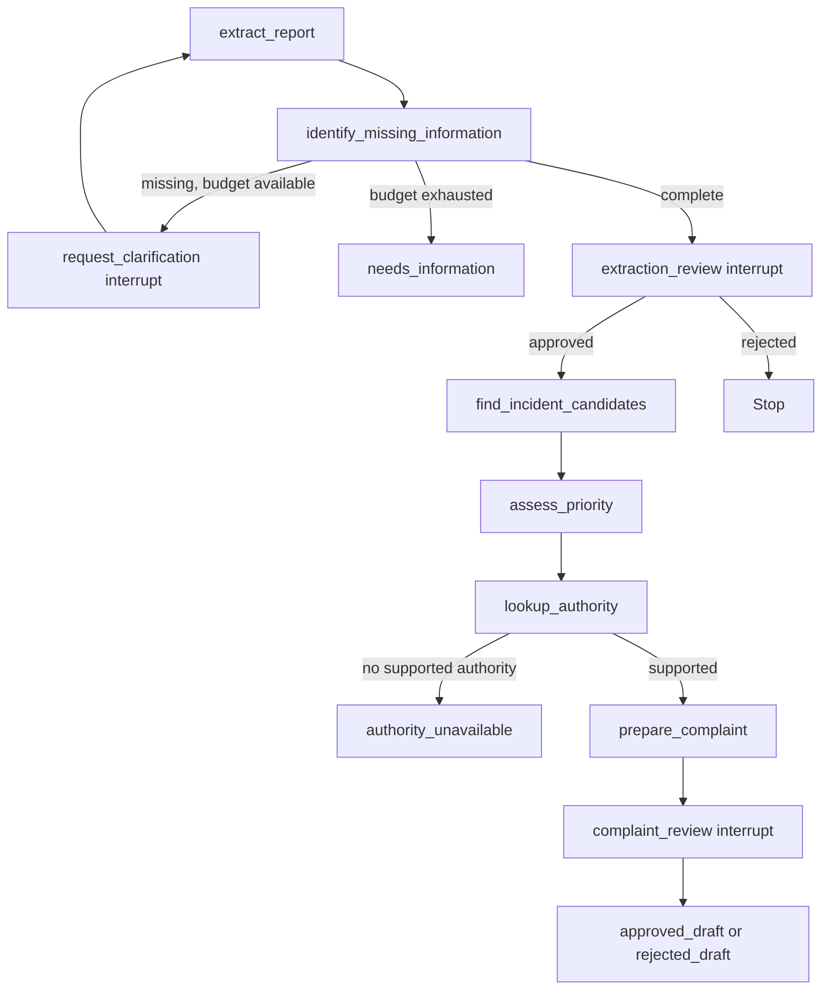

# CivicMesh AI workflow

Branch: `feat/ai-workflow`. This package implements the AI side of report processing
and follow-up assessment. Frontend, authentication, storage access, matching retrieval,
official-source ingestion and worker/job persistence remain backend/frontend responsibilities.
No automatic complaint submission or incident merge is implemented or exposed as a tool.

## Implemented

| Capability | Behavior |
| --- | --- |
| Text, photos and recorded audio | Gemini structured extraction, Hindi/English instructions, explicit model configuration |
| Missing information | Unknown fields remain null; category conflicts and absent confirmed locations trigger clarification |
| Clarification | Original report preserved; at most three answer/re-extraction rounds |
| Human review | Extraction, complaint draft and follow-up assessment each pause before handoff |
| Incident candidates | Calls owner-authorized backend matching, validates category/IDs, never merges |
| Priority | Advisory assessment with exact quotations from approved observations |
| Authority recommendation | Calls backend source retrieval; rejects invented authorities and source IDs |
| Complaint packet | Validated draft plus trusted recipient, confirmed location, evidence IDs and source provenance |
| Follow-up | Four supported outcomes; same-location before/after images required for visual condition claims |
| Checkpoints | Required injected saver; local SQLite and PostgreSQL adapter contexts provided |
| Verification | Unit/workflow tests, real SDK serialization over local HTTP doubles, separate-process durable restart test, AI CI |

`authority_status` in report output stays `unknown`; `submitted` stays `false`.
Follow-up results are attributed to `ai_assessment` and explicitly do not update
authority status. A citizen or AI observation is not a government response.

## Install and test (Windows PowerShell)

From the repository root:

```powershell
git branch --show-current
Set-Location backend/app/ai
uv sync --frozen --extra checkpoints --python 3.11
uv run --frozen ruff check .
uv run --frozen pytest -q
uv run --frozen civicmesh-extract --help
```

This isolated project installs as `civicmesh_ai`; pyproject.toml and uv.lock pin its
dependencies without modifying the backend teammate's dependency setup. At integration,
install this local package in the backend environment or coordinate consolidating manifests.
The optional `checkpoints` extra installs SQLite and PostgreSQL checkpointer adapters.

## Live extraction

Set `GEMINI_API_KEY` and `GEMINI_MODEL` in the worker/process environment. Choose a model
available to your project that supports structured output and the required image/audio types.
There is deliberately no guessed model default. `.env.example` documents the variables;
the module does not auto-load `.env` files. Never commit keys or paste them into chat.

For your own consented UTF-8 report in the ignored `private-inputs/` folder:

```powershell
uv run --frozen civicmesh-extract --text-file private-inputs/report.txt --allow-paid-call
```

For a real image or recorded audio file, add one or more `--media` arguments:

```text
--media <existing-evidence-uuid> image/jpeg private-inputs/photo.jpg
--media <existing-evidence-uuid> audio/webm private-inputs/recording.webm
```

These placeholders describe arguments, not sample operational IDs. Supply the genuine
evidence UUID associated with your file. Text is optional when media is supplied. The CLI
does not authenticate storage ownership; it is an operator tool for explicit local inputs.
Production workflows fetch only backend-authorized media. The CLI performs extraction only,
not report creation, job processing, routing or complaint submission.

The flag authorizes transmitting the input to Gemini and potentially incurring charges.
The output appears in your terminal and can contain private citizen information.
No live paid calls were made during implementation/testing.

## Media constraints

- Images: JPEG, PNG, WebP, at most 10 MiB each.
- Recorded audio: WebM, Ogg, MP4, MPEG/MP3, WAV, at most 20 MiB each.
- At most 10 attachments, and **12 MiB combined raw bytes per inline request**. The
  combined limit is tighter than individual limits to leave base64/JSON headroom.
- Reject unknown MIME types, obvious signature mismatches, empty objects, duplicate IDs,
  missing/extra media and oversize requests before model calls.
- The AI package never fetches media URLs or uploads extra copies through Gemini Files API.
  Files exceeding the inline limit require smaller/compressed inputs through the backend.
- Signature checks are only a first filter. Backend must verify actual content, decoding,
  ownership, storage binding, consent and retention. Strip sensitive metadata as appropriate.
- Only evidence IDs enter checkpoints; raw bytes stay transient. Confirmed coordinate fields
  and report/incident identifiers are excluded from model evidence, although citizen text and
  images themselves can disclose location or personal information.

## Full report workflow



`graph.report.build_report_workflow(provider, tools=..., checkpointer=...)` builds the
complete flow. `graph.workflow.build_workflow(...)` retains extraction-only support.
Start the full flow with `initial_report_state(report, owner_id=verified_owner_id)`.
`ReportInput` contains report_id, optional text/evidence_ids, category and confirmed location.
Text or evidence is required. Backend APIs must coordinate these internal schemas before
exposing them; this package does not independently define the shared HTTP contract.

All tools receive the authenticated owner, stored report ID, effective category and the
latest citizen-confirmed location. Match candidates must be unique and category-compatible.
Sources must include document_id, authority_id/name, jurisdiction, URL, retrieved_at,
verified_at and a supporting passage. The backend verifies officialness and locality.
The model cannot create tool permissions, choose arbitrary fetch URLs or change identity.

No retrieved sources means no routing model call and no complaint. A recommendation is
accepted only if every citation belongs to its supplied authority. Complaint observations
must be exact excerpts from approved extraction text, and its citations must be a subset of
the recommended authority's sources. This checks binding, not semantic truth: a human must
still verify that the draft's wording, source interpretation and requested action are sound.

Final packet includes evidence references and original source metadata; it is private and
does not imply publication, submission or receipt. Review approval is limited to that draft.
External submission, if added later, needs separate authorization and idempotency.

## Follow-up workflow

Use `graph.follow_up.build_follow_up_workflow(...)` and `initial_follow_up_state(...)`.
Input: existing incident_id, baseline extraction, distinct baseline/follow-up evidence IDs,
optional citizen text, timezone-aware observed_at and a confirmed same-location flag.

Outputs: appears_resolved, partly_resolved, persists, insufficient_evidence.
Reuploaded baseline images with identical bytes do not count as new follow-up evidence.
Missing before/after evidence or missing same-location confirmation returns
insufficient_evidence without a model call. Audio/text alone cannot establish a visual
condition. Stronger outcomes must cite supplied images from both time points. A real model
must also judge visibility/comparability; the code cannot infer those facts from file headers.
Every outcome pauses at `follow_up_review`. The reviewed result records attribution and
observed_at, and never changes official authority status.

## Resume and durable storage

`ainvoke` returns pending interrupts under `__interrupt__`; each has a kind and private payload.
Reply shapes:

- clarification: optional text/category/location, with at least one nonempty answer.
- extraction_review, complaint_review, follow_up_review: `{"approved": true}` or false.

Resume with `Command(resume=validated_reply)` using the **same persisted thread ID**.
Never reuse a completed thread for another report, change its owner, or accept arbitrary
state updates from a client. The backend must authorize every read/resume, serialize concurrent
answers, and prevent stale/repeated requests. Thread IDs are not authentication.

For local durable development, use `checkpoints.sqlite_checkpointer(Path(...))` as an async
context manager. The file contains private report state; use a protected, ignored path.
A test closes its initial saver, starts a distinct process to resume the extraction review,
then reopens the resulting complaint review. Completed model nodes are not rerun in that test.

For production, use `checkpoints.postgres_checkpointer(secret_psycopg_dsn)`. This adapter
opens an existing PostgreSQL checkpoint store; it never runs remote schema setup. The backend
must inspect its database and explicitly provision the installed saver's schema using its
reviewed migration process before use. Use a PostgreSQL DSN, not a SQLAlchemy URL, and require
appropriate TLS. PostgreSQL connection/schema/RLS behavior was not tested here.

## Backend handoff

The backend teammate implements `tools.interfaces.BackendTools`:

1. load_evidence: owner-authorized, report/incident-bound private bytes; no raw client URLs.
2. incident_candidates: location/category/time/similarity matching, at most 20 candidates.
3. authority_sources: verified official passages for the locality, at most 10 documents.

The backend also supplies authenticated context, stored report/incident IDs, worker/jobs,
durable checkpoint provisioning, result persistence and private retrieval. Run graphs in
the worker, not a request handler. Model calls have a 30-second timeout and one SDK attempt.
The worker owns a bounded persistent retry budget and must prevent duplicate consequential
actions. Checkpointing alone does not guarantee exactly-once execution or paid-call deduplication
when a process crashes between a provider response and checkpoint commit.

Without worker retries, a report uses at most four extraction calls plus one each for
priority, routing and drafting (at most seven model calls). A follow-up uses at most one
model call. Missing sources and insufficient comparison evidence reduce these counts.

Translate AIError.code/retryable into job/API errors; sanitize database and Pydantic errors
without returning their private input values. Disable remote tracing unless explicitly
approved for citizen data. Define retention/deletion for evidence, state and logs.

## Remaining integration verification

Local verification: 69 tests passed on Python 3.11, Ruff lint passed, and the package
imports and compiles. This includes every Gemini response schema through the SDK using
an isolated HTTP transport, with no external model requests.

AI-owned functionality is implemented and locally tested. These checks require external setup:

- Supply real Gemini credentials/model and consented Hindi/English text, photos and audio;
  check extraction quality, uncertainty, prompt-injection resilience, latency and costs.
- Backend implements the three tool adapters and supplies genuine verified sources/evidence.
- Provision and test PostgreSQL checkpoint storage, job retry recovery and ownership isolation.
- Connect frontend clarification/review flows through the authenticated API.
- Run a genuine report -> persistence -> AI -> frontend result, then a real follow-up.

Automated tests use isolated fixtures only; no fixture becomes product/demo data. Live model
accuracy, production durability, official routing correctness and end-to-end integration are
not claimed by passing offline tests. Do not report fabricated success or impact metrics.

Official references consulted:
- [Google Gen AI SDK](https://googleapis.github.io/python-genai/)
- [Structured output](https://ai.google.dev/gemini-api/docs/structured-output)
- [Image understanding](https://ai.google.dev/gemini-api/docs/image-understanding)
- [Audio understanding](https://ai.google.dev/gemini-api/docs/audio)
- [LangGraph interrupts](https://docs.langchain.com/oss/python/langgraph/interrupts)
- [LangGraph persistence](https://docs.langchain.com/oss/python/langgraph/persistence)
