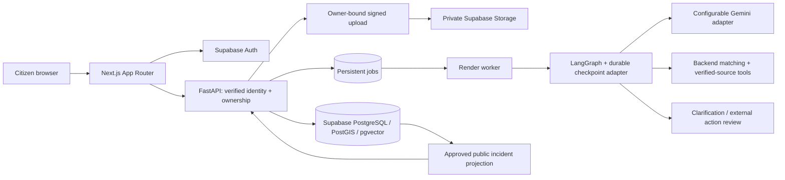

# Architecture and trust boundaries

Arrows show the intended integration; persistence, queue execution and public retrieval are not
wired yet. Current routes deliberately fail closed. SQLAlchemy 2 with psycopg is the sole SQL
access approach. HTTPX serves Auth verification and future source ingestion, not a parallel
PostgREST data layer. Keep synchronous SQLAlchemy work in sync routes or worker threads.

API request handlers will atomically commit a report, validated evidence bindings and a queued
job, then return 202. They must not launch long AI work or rely on FastAPI background tasks.
The worker claims with `FOR UPDATE SKIP LOCKED`, sets a lease token and deadline, heartbeats,
and fences completion with that token. Retries use bounded attempts and persisted backoff.
On exhausted retries, store a sanitized failure. An expired lease can be recovered; external
side effects require stable idempotency keys. Test crash after claim, after model response and
before completion. Exactly-once execution is not claimed.

`CheckpointStore.saver()` is an explicit replaceable interface; no in-memory production fallback.
Before activating workers, add and initialize a PostgreSQL LangGraph saver, coordinate checkpoint
and job transitions, and test process restart/resumption. `workflow_runs.thread_id` is stable and
owned through its job. Clarification answers require owner authorization; a clarification interrupt
ends that pass, and a future resume handler must re-extract from validated merged input.
Complaint review interrupts do not send anything. There is no authority-submission tool.

Priority, complaint generation and follow-up nodes return explicit 501 errors. The Gemini adapter
supports structured text extraction with Pydantic validation; image/audio transformation remains
future work. Missing category/summary/language stay null. Backend tools supply candidate/source IDs;
model text cannot supply arbitrary fetch URLs, SQL, identity or tool permission changes.

PostGIS uses `geography(Point,4326)`, GiST indexes and metres for distance queries.
API/UI: `{latitude, longitude}`; Leaflet: `[latitude, longitude]`; SQL:
`ST_SetSRID(ST_MakePoint(longitude, latitude),4326)::geography`. Never swap these orders.

Embeddings use `vector(768)` and cosine HNSW. This is a storage design choice, not an assumed
Gemini embedding model. No embeddings are generated by the foundation. Select an actual
embedding model supporting the chosen dimension, record its identifier, and backfill genuine
source chunks. A dimension change requires a migration and regenerated vectors/indexes.

The one-locality pilot boundary is intentionally not invented. The team must select and configure
the actual boundary before accepting production reports or matching across locations.
