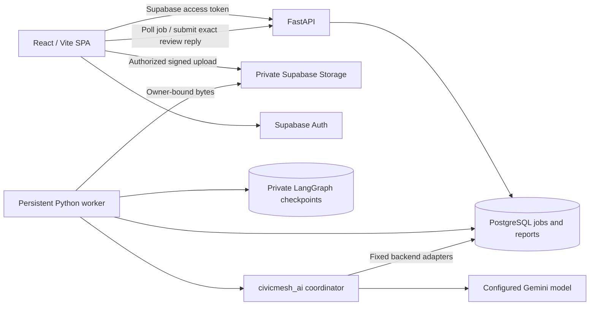

# Integration audit and readiness evidence

The three feature PRs were merged at `6718ae1`. Integration work is isolated on
`feat/project-integration` in PR #4; `main` is preserved until the integration PR
is separately reviewed. The original untracked `CivicMesh-Team-Roles.txt` is
preserved. Historical role plans and `merge-review.md` describe earlier states;
this document describes the integrated implementation.

## Actual architecture and flow

The browser never imports the AI package or sees model/database/server keys. An
authenticated mutation derives its owner from a verified citizen JWT, applies a
shared write limit and validates its schema. Upload preparation signs a private
destination; report creation inspects uploaded bytes before atomically binding
evidence, inserting the private report and creating its persistent job. Original
report fields remain unchanged during clarification and result storage.

Workers select eligible persistent jobs, acquire PostgreSQL session exclusion,
persist running state, invoke the AI coordinator and commit the resulting paused
or completed state. The same lock covers checkpoint access and the result commit.
The stable workflow ID is the job ID. The frontend polls `/jobs/{id}`, renders
escaped observations/drafts, and sends the exact checkpoint/interrupt plus a
typed clarification or strict boolean review. There is no automatic complaint
submission, incident merge, government update or publication.

## Implemented, deliberately unavailable and owner-dependent features

| Area | Integrated behavior | Remaining limit / owner dependency |
|---|---|---|
| Frontend | React/Vite/TypeScript; photo/audio/location reporting; Auth; private history; jobs/results/reviews; public incident lists/detail; private follow-up submission | The original Next.js proposal was not implemented; existing Vite code is retained as source of truth |
| API contract | OpenAPI export and generated TypeScript types; real upload/report/job paths; standardized errors including router errors | No invented fields such as extraction confidence or local authority status |
| Auth | Project issuer/audience/expiry/UUID/citizen-role checks; ES256/RS256 JWKS; optional legacy HS256 | Genuine project signing/rotation and email flow require staging verification |
| Private data | Owner checks on reports/jobs/replies/follow-ups; media IDs must belong to the report or authorized follow-up/baseline; auth changes reset private UI state | No app-level account/data-erasure console; owner retention procedures cover DB, Storage and checkpoints |
| Worker | Real executable runner, durable coordinator, bounded timeouts/backoff/failure budget, stale-job recovery and saved human reviews | Provider key/model, database and worker hosting must be configured by owner |
| Follow-ups | Separate private row/job; fresh bound uploads; owner-authorized before/after media; insufficient evidence when no baseline exists | Another citizen's private photo is not made available as a baseline; no automatic public timeline update |
| Matching | Category, recent age, location distance; approved public candidates; no merge side effect | Current pilot matcher filters approved recent incidents then calculates distance in Python; large catalogs need a separately measured indexed-query optimization |
| Authority sources | Owner-run verified HTML/text ingestion, bounded SSRF-safe fetch, exact passage/provenance, exact pilot jurisdiction and radius | Owner must supply/reverify genuine sources; no PDF/OCR, embeddings or fabricated catalog |
| Complaints | Supported private draft and explicit human review; submitted=false and authority_status=unknown | No external complaint dispatch, receipt or authority-response integration |
| Public incidents | Approved projections and authority-only timeline fields | There is no publication/moderation UI. Empty catalog remains empty until genuinely moderated records exist |
| Campaigns/support/rewards | Explicit unavailable states; prototype local mutations removed | Outside this pilot; no backend exists for them |
| Hosting | Non-root Docker image for API/worker; Vercel SPA deep links and response headers | Actual resources/domains, quotas, billing and production authorization remain with owner |

## Contract and ownership audit

Follow-up baselines are selected only when authorized images fit together with
the new upload within the 12 MiB inline budget. If no baseline fits, the workflow
returns insufficient evidence instead of loading an oversized comparison or
claiming visual resolution. A target that is no longer public is rejected before
new follow-up processing.

| API | Identity and behavior |
|---|---|
| `POST /uploads/prepare` | Verified user plus write quota; private ticket; only then persist owner-bound metadata |
| `POST /reports` | Verified user plus quota; supplied owner IDs forbidden; optional bounded idempotency header; changed replay payload rejected |
| `GET /reports` | Owner-only history, 20 per page by default, maximum 100 |
| `GET /reports/{id}` | Owner check before private observation/result response |
| `GET /jobs/{id}` | Owner-only status/prompt/result; no raw graph state or task exception |
| `POST /jobs/{id}/answers` | Owner, quota, row lock, waiting stage, checkpoint, interrupt and action-specific schema checked before enqueue |
| `POST /reports/{id}/answers` | Compatibility clarification endpoint with the same saved-action validation |
| `GET /incidents` and `/{id}` | Approved public projections only; paginated lists; no private source report or media leakage |
| `POST /incidents/{id}/follow-ups` | Verified citizen, quota, public target, fresh owned uploads, same-location confirmation, idempotent private job |
| `GET /incidents/{id}/follow-ups/{follow_up_id}` | Owner-only private follow-up result |
| `/health/live`, `/health`, `/health/ready` | Distinct process, diagnostic and dependency/worker readiness checks; no model calls |

Job states are pending/running/waiting_for_input/completed/failed. Report/follow-up
states are pending/processing/waiting_for_input/processed/failed. A completed AI
outcome can still be rejected, need information or lack a supported authority;
the UI displays the actual outcome. Private responses use no-store; errors use
code/message/request_id. Browser auth is bearer-token based, without API cookies.

## Database, migrations and privacy review

Migration 1 creates profiles, official sources/chunks, reports, incidents,
reversible incident memberships, evidence, jobs, runs and status events, with
PostGIS/vector extensions and RLS. Migration 2 aligns owner foreign keys with the
profile model, adds private follow-ups, subject-specific jobs, failure/backoff
fields, uniqueness, heartbeat/rate-limit tables and coordinate validation/triggers.
Longitude is X and latitude is Y. Initial spatial indexes are retained. The vector
column is unused; there is no live embedding assumption in application code.

Client data-table writes are mediated by the API. Owner reads are constrained by
RLS. Operational heartbeat/rate rows have no anonymous/authenticated access. The
evidence bucket is private and read policy requires verified owned metadata;
no public policy grants raw citizen timeline/checkpoint access. Checkpoints have
their own non-exposed schema and explicit provisioning command. SQL migrations
do not auto-run at startup and have not been applied to an owner project.

Uploads allow only the listed image/audio formats, at most 10 MiB per file and
12 MiB inline combined. Binding verifies actual size, MIME header, magic signature
and SHA-256, and the worker rechecks before providing bytes to AI. This is not a
claim of full media decoding, malware scanning or automatic removal of faces/EXIF;
citizens must avoid sensitive observations and the owner must approve provider
data handling and retention. Media bytes are not placed in graph checkpoints.

Requests are bounded to 64 KiB JSON and a configured timeout. Mutations share a
per-user hourly database quota. Public read pages are bounded; edge-level traffic
protection and host resource limits remain deployment settings. CORS is explicit;
server credentials are repr-redacted, validation input values are hidden, database
parameters are hidden, production SQL echo is disabled and worker errors contain
only sanitized type/reference information. Reviewed source fetching resolves and
pins allowed public IPs, revalidates redirects, limits bytes and does not use
environment HTTP proxies. Untrusted content never grants tools or identity.

## Recovery and remaining operational limits

Failure counts are persisted and never reset by citizen replies. The attempts
counter records execution slices, including legitimate review resumptions;
`max_attempts` is the stored failure budget. Retryable errors wait with bounded
backoff; invalid output is terminal. Session exclusion prevents competing workers
from running the same workflow. Known Supabase transaction-pooler endpoints are
rejected; other providers must also use real session/direct connections.

A new saved checkpoint is authoritative after a result-commit crash: the worker
inspects it rather than reapplying an older approval. If a previously recorded
checkpoint is missing, processing fails for recovery rather than silently paying
for a new workflow. A crash between a model response and its checkpoint write can
still repeat a paid call; exactly-once provider billing is not guaranteed.

## Verification record

Late CodeRabbit findings from the merged frontend were checked against current
code. Implicit `(0,0)` selection and a viewport that failed to follow manual
coordinates were valid: inputs now start blank, an explicit coordinate choice is
required, and the map centers on that choice. The request to restore road/lighting
categories was skipped because the owner's integration prompt restricts the pilot
to garbage and water leaks; current filters/types follow that scope. Older product
concept notes are marked historical.

The local and CI checks use isolated fixtures, not fake runtime fallbacks. The
frontend browser integration drives the actual API, ORM, job worker, LangGraph,
durable SQLite checkpoints and UI, while provider/Auth/Storage services are test
doubles located exclusively in test directories. It covers upload, real routes,
polling, clarification, human approval, persisted reload, cross-owner denial and
sign-out data removal. Separate tests exercise provider failures, invalid output,
prompt-injection boundaries, missing sources, insufficient evidence, crash windows
and retry bounds. Generated contracts are compared in CI.

The PostgreSQL CI uses a disposable `supabase/postgres` container and actual SQL
migrations/PostGIS/vector/RLS. Auth/Storage schemas are local service fixtures;
this does not replace managed Supabase staging smoke checks. It tests cross-owner
reads, blocked client updates, private object policy, coordinate triggers, real
queue idempotency races, worker ORM/schema compatibility, advisory exclusion and
PostgreSQL checkpoint persistence across connections. The container CI verifies
backend/AI/psycopg imports and excludes test harnesses from the production image.

Exact commands and the final result counts are recorded in
[verification.md](verification.md). Windows browser cases reported passes locally,
but this managed shell required interrupting subprocess teardown; Linux CI runs
the complete commands to successful exit. No genuine provider call, managed
Supabase operation, public deployment or production change is claimed.

## Readiness verdict

**Ready for staging setup and verification; not approved for production.**
Owner actions: select real locality/domains/providers; configure genuine credentials
and direct/session database connections; apply reviewed staging migrations and
private checkpoint setup; supply genuine official sources; run authenticated,
real-provider smoke checks; approve quota/billing, retention, backups and rollback;
then separately authorize production resources/migrations/deployment. See the
[ordered deployment runbook](deployment-runbook.md) and
[complete environment table](environment.md).
